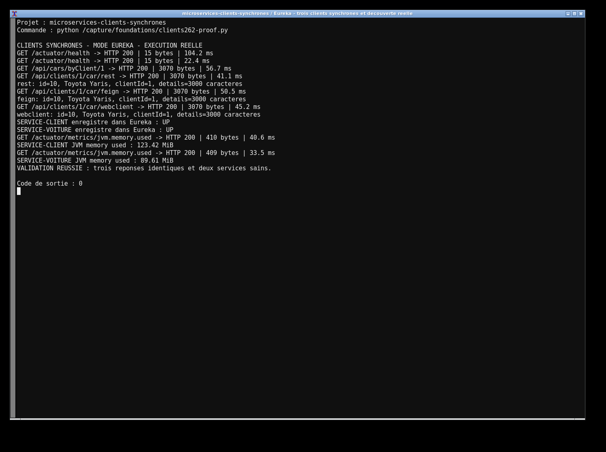
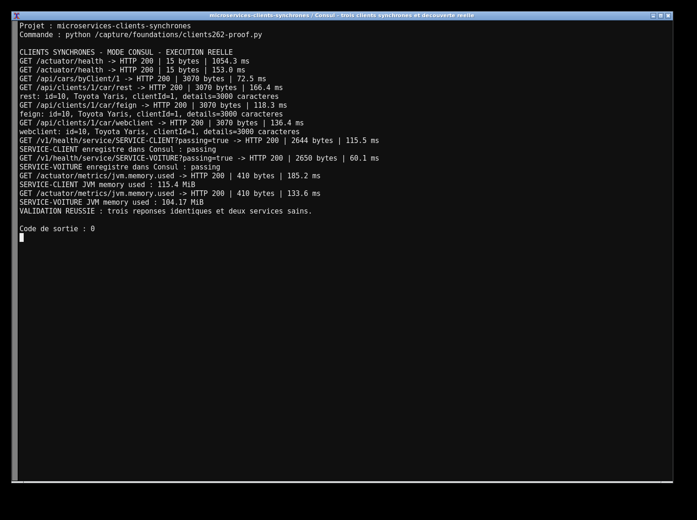

# Étude de cas — RestTemplate, Feign et WebClient

J’ai comparé trois clients synchrones entre SERVICE-CLIENT et SERVICE-VOITURE. Les trois endpoints renvoient le même objet de 3 Ko, avec un délai serveur de 20 ms. L’API Voiture fonctionne en mémoire pour isoler le coût des appels HTTP.

```bash
mvn clean verify
# Mode Eureka : lancer les trois jars dans des terminaux séparés
# Mode Consul : reconstruire sans starter Eureka
mvn -Pconsul clean verify
```

En mode Consul, lancer les services avec `--spring.profiles.active=consul` et démarrer un agent sur 8500. Les profils Maven sélectionnent exclusivement le starter de découverte adapté.

Les routes Client sont `/api/clients/1/car/rest`, `/feign` et `/webclient`. Les trois utilisent le nom logique SERVICE-VOITURE ; WebClient utilise volontairement `block()`.

Le plan JMeter monte de 10 à 500 utilisateurs. Les mesures réelles de latence, débit et ressources sont dans `results/`, avec les essais de panne et l’analyse comparée. Les erreurs distantes renvoient 503. Les captures montrent les enregistrements et les réponses des services réellement lancés.



